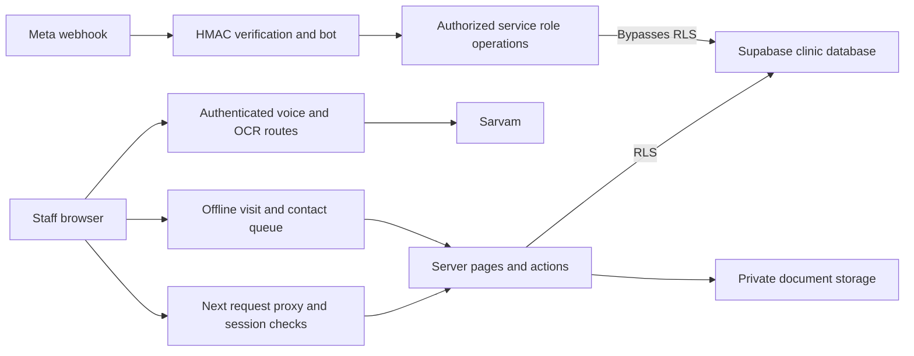

# MatruSetu project architecture and bug audit

Reviewed on 27 November 2026 against GitHub `main` at `fa76438`, including PR 10's doctor-profile and emailed staff-invitation changes. The repository is named Matruseva; the application calls itself MatruSetu. The requested branch is `div-edit`.

The reported calendar problem affects both visit entry forms: their date controls were text inputs. This branch restores native date pickers and keeps dates in ISO format through submission. It also removes a configuration default that silently enabled demo sessions and excludes generated browser traces from linting. There are 19 findings below: 3 fixed here and 16 remaining in the repair backlog.

This is a source audit plus automated checks against synthetic demo data. It does not establish that every possible bug has been found. Production Supabase policies, applied migrations, Vercel configuration, real speech/OCR quality, and external WhatsApp delivery need integration verification in their respective environments.

## How the application works

### GitHub and deployment

`origin` is `https://github.com/VeerbhadraMahant/Matruseva.git`, with `main` as the default branch. The review started at `8bd8960`; a later fetch brought in `fa76438` before final validation. An isolated worktree was created for `div-edit` so the original checkout's existing font changes stayed outside the PR.

`.github/workflows/ci.yml` runs lint, route type generation and TypeScript, Vitest, migration syntax validation, the production dependency audit, and `next build --webpack`. The webpack build is required by Serwist. Vercel builds the Next application; there is no separate long-running backend service in this repository. Database migrations must be applied separately before application deployment. Browser tests are local/manual and are not part of CI.

### Requests and authentication

`proxy.ts` delegates session handling to `lib/supabase/middleware.ts`. Public routes include the landing/auth pages, offline fallback, signed counselling links and WhatsApp webhook. Protected requests refresh or verify Supabase authentication and redirect signed-out users to login. Missing authentication configuration fails closed on protected routes.

`lib/auth.ts` resolves the current identity and clinic from verified claims and the user's profile. A user without a profile goes to onboarding. Server actions enforce identity and use a Supabase client carrying the caller's cookies. Database row-level security limits normal reads and writes to the caller's clinic. Doctor-only settings operations add an application-level role check. Doctor profiles are editable; demo profile edits use the local demo store.

Staff invitation uses Supabase's email invitation flow, a custom invitation email template and `/auth/staff-invite`. Acceptance verifies the invitation token and staff profile, then sets a session-bound proof that allows password setup. Live email delivery requires the documented SMTP, invitation template and redirect configuration. Profile creation failure triggers cleanup of an account created by that invitation request.

There are browser, server-session and service-role Supabase clients under `lib/supabase/`. The service-role client bypasses RLS and is used for staff account administration, signed public counselling pages and the WhatsApp bot. Those callers must perform their own authorization checks.

Demo mode uses fabricated patients and a local `.matrusetu-demo-store.json` file instead of Supabase. It is suitable for local demonstrations, not durable multi-instance storage. After this fix it requires an explicit server `DEMO_MODE=1`; omitting the variable no longer activates it through Next configuration.

### Clinic screens and data

`app/(app)/layout.tsx` loads the current clinic, language, navigation, search, toasts and offline synchronization. Server components fetch data; client components provide forms, dialogs, recording and immediate feedback. English, Hindi and Marathi messages are defined under `lib/i18n/messages/`; the locale is stored in a cookie.

The shared `getClinicSnapshot()` in `lib/snapshot.ts` batches active pregnancies, care-event status, follow-up risk and latest visits. React request caching shares that snapshot across the dashboard, patient registry and call queue. `app/(app)/today/view-model.ts` groups booked visits and care windows closing within the next seven days. The call queue prioritizes follow-up needs. The registry adds search, filters and display pagination.

The main database records are clinics, profiles, schedule templates/items, patients, care events, visits, contact logs and documents. One `patients` row represents one pregnancy. The later `person_id` migration groups pregnancies belonging to the same mother. Derived views expose care-event status, follow-up risk, contact summaries and each patient's latest visit.

### Registration and pregnancy scheduling

Registration validates demographics and LMP in `app/(app)/patients/actions.ts`, detects matching active registrations, calculates EDD, and builds ANC events from the clinic template. `create_patient_with_schedule` inserts the pregnancy and its schedule in one database transaction. The obstetric questionnaire is stored with the pregnancy.

`lib/pregnancy.ts`, `lib/today.ts` and `lib/format.ts` handle pregnancy dating and date-only values, with the clinic calendar based on Asia/Kolkata. `lib/schedule.ts` generates template windows and marks windows already missed at registration as late bookings. Its regeneration diff preserves completed and manually skipped events.

Editing a patient can regenerate open events when LMP or Rh status changes. Closing pregnancy records delivery details and marks remaining events skipped. These later multi-step operations are not atomic; the backlog describes their failure cases.

### Dictation and visit saving

The patient page renders `VisitForm`. Its voice button lazily opens `VoiceScribeModalContent`, records an audio clip, and posts it to the authenticated `/api/voice-vitals` endpoint. `lib/sarvamStt.ts` sends the clip to Sarvam. `lib/voiceScribe.ts` parses English, Hindi, Marathi and mixed-language transcripts into candidate readings. Staff review and verify extracted values before applying them to the form. Dictation supplies vitals and symptom notes; follow-up booking is entered separately.

Both `VisitForm` and `SplitScreenVisitWorkspace` save through `saveVisitAction` in `components/offlineActions.ts`. It uses `submitOrQueue` to either call `recordVisit` or store the write in IndexedDB when the network is unavailable. `recordVisit` normalizes dates, validates ranges using Zod, inserts a visit and invalidates affected screens. Database `client_request_id` uniqueness makes retries of the same queued write idempotent.

Previously, both date fields in both forms used `type="text"` with a date-format placeholder. They now use `type="date"`, which supplies the browser's calendar control and submits `YYYY-MM-DD`. The existing server normalizer still accepts old `DD/MM/YYYY` values already stored in offline queues. Native date display follows the browser's locale; storage remains ISO.

`OfflineSync` tags queued visits/contact writes with the user ID, retries them with backoff, and exposes failed writes for retry/discard. Sign-out clears the queue after the existing confirmation when unsynced changes exist. The service worker supplies static asset caching and an offline fallback; this is not a complete offline database replica.

### Documents and OPD

`DocumentUploader` accepts camera images and PDFs. `lib/ocr.ts` prepares images, tries server OCR through `/api/ocr` and Sarvam Document AI, then falls back to browser Tesseract. Digital PDFs can supply their text layer; scanned pages need OCR. Extracted text is indexed for search and passed to the lab-value parser for review.

Documents begin in the inbox or are attached directly to a patient. Assignment can also complete a care event. OPD register pages use the same storage/document model with a dedicated document type. Private files are accessed through short-lived signed URLs. Doctor-only deletion removes the database record and then the stored object.

### Calls, WhatsApp and counselling

Contact actions record manual and batch outcomes. SQL risk views and `lib/risk.ts` use booked-visit lateness, overdue critical events and recent unanswered contacts. Automated reminder logs are excluded from successful manual-contact counts. The reminder button composes text and logs an outcome; staff still use the WhatsApp link to send it.

The webhook verifies Meta's HMAC before using the service-role bot. The bot resolves a patient, detects language and confirmation/reschedule/information intent, logs applicable outcomes and prepares a reply. The webhook sends that reply through Meta when outbound credentials exist. This repository has no proactive outbound reminder scheduler.

`lib/voiceCounselor.ts` builds multilingual counselling text from patient data. Signed, expiring `/listen/<token>` links let a mother open the public audio interface. Consultation recording is a separate flow: Sarvam batch transcription, signed job tokens bound to a clinic/patient, de-identification, and Gemini summarization. The consultation result is presented for copying; it is not automatically saved as a visit.

## Confirmed findings

Priority P1 means a significant integrity, access-mode or core workflow problem. P2 means a functional or reliability problem. "Code confirmed" describes a determinable path in the implementation; failure injection against a live database was not performed.

| ID | Priority | Status | Finding and evidence |
| --- | --- | --- | --- |
| B01 | P2 | Fixed | **No calendar in visit entry.** `VisitForm.tsx` and `SplitScreenVisitWorkspace.tsx` used text controls for both visit dates. Native date inputs restore the calendar before and after dictation. Browser regression coverage includes dictation, selected dates, saving and reload. |
| B02 | P1 | Fixed | **Demo mode enabled by default in Next configuration.** `next.config.ts` set `env.DEMO_MODE` to `process.env.DEMO_MODE ?? "1"`. Next inlines configuration `env` values, overriding the intended opt-in guard in `lib/demo.ts`. With configuration omitted, demo login became available; with no Supabase config, requests could enter the synthetic clinic without a cookie. Removed the config injection and added a configuration regression test. This is an unintended demo-session bypass, not evidence of access to another clinic's real records. |
| B03 | P1 | Open, code confirmed | **Read failures masquerade as missing or healthy data.** `lib/snapshot.ts` destructures only `data` from all four queries, then defaults missing risks to `on_track` and events to empty arrays. Patient-detail, documents and OPD reads also discard errors. For example, a failed risk-view query can hide follow-up risk, and a missing `latest_visits` migration hides current readings. Check query errors and display a failed/incomplete state before deriving counts or flags. |
| B04 | P1 | Open, code confirmed | **Patient edits can leave schedule dates inconsistent.** `updatePatient` updates the patient first, then performs template reads and individual care-event updates/inserts without handling their errors. A rejected schedule write still leads to a success response. Use a transaction/RPC covering dating and schedule regeneration, and return failures. |
| B05 | P1 | Open, code confirmed | **Pregnancy closure can partially succeed.** `closePregnancy` saves delivered status, then ignores the care-event skip update result. A failed second write leaves open ANC events associated with a delivered pregnancy. Both writes need one transaction and an active-status condition to avoid concurrent closures overwriting one another. |
| B06 | P2 | Open, code confirmed | **Delivery remarks are discarded.** `ClosePregnancyModal` collects `notes`, and `closePregnancySchema` accepts them, but the production patient update never persists them. The closure migration has no delivery-notes field. Store and display the remarks, or remove the field until persistence exists. |
| B07 | P2 | Open, code confirmed | **Clearing gravida or para stores zero.** `updatePatientSchema` uses `z.coerce.number().nonnegative().optional().or(z.literal(""))`. The numeric branch accepts `""` as `0` before the empty-string branch can run. This changes unknown history into a measured zero. Registration already preprocesses blank fields; apply the same behavior to editing while preserving an explicit `0`. |
| B08 | P1 | Open, code confirmed | **Editing accepts an LMP in the future.** Registration rejects future LMP, but the edit schema only uses `z.iso.date()` and the edit input has no maximum. A valid future date reaches the patient update and schedule regeneration. Apply the same clinic-today constraint on the server for creation and editing. |
| B09 | P1 | Open, code confirmed | **A document can complete another patient's care event within the same clinic.** `assignDocument` validates patient and care-event identifiers independently, updates the document, then updates the event using only its ID. RLS checks clinic ownership, not equality between the selected patient and event's patient. Verify that the event belongs to the selected patient and assign/complete atomically. Also reject nonexistent document updates rather than completing an event after a zero-row update. |
| B10 | P2 | Open, code confirmed | **Failed storage deletion leaves an orphan with no normal retry path.** `deleteDocument` deletes the row before removing the object. If removal fails, it returns an error after the row is gone. Retrying can only return document not found, while the object remains in storage. Use a durable deletion job/tombstone or compensating cleanup that retains the storage path until removal succeeds. |
| B11 | P1 | Open, code confirmed | **WhatsApp retries duplicate contact outcomes and replies.** The webhook ignores `msg.id` and has no processed-message uniqueness guard. Replaying a valid signed payload runs the bot again and can insert another contact and send another reply. Persist Meta's message ID and handle processing idempotently. Duplicate confirmation/reschedule outcomes also distort contact history. |
| B12 | P1 | Open, code confirmed | **WhatsApp acknowledges failures as success.** Confirmation/reschedule handlers ignore the contact insert's returned error, but return success text. The webhook also ignores non-2xx responses from Meta `fetch` and returns `EVENT_RECEIVED`. A failed record write can therefore be described to the patient as recorded, and failed deliveries have no retry record. Check both database and Graph results, with durable retry/error handling compatible with B11. |
| B13 | P2 | Open, code confirmed | **Formatted stored phone numbers may not resolve in the bot.** Registration stores the typed number. The bot strips non-digits only from the incoming number and searches the stored `phone` using a contiguous last-ten-digit suffix. A stored `98765 43210` will not match `%9876543210`. Normalize a stored searchable phone key and preserve the display form separately. |
| B14 | P2 | Open, code confirmed | **Patient counselling can announce the wrong follow-up date.** The patient page passes `firstOverdue?.dueFrom` to `VoiceCounselorButton` instead of the booked `nextVisit`. A patient booked for next week with an old overdue scan receives that scan window's start as the stated next visit. Pass the actual appointment and describe overdue tasks separately. The public listen page also omits the booked date entirely. |
| B15 | P2 | Open, code confirmed | **Document and OPD lists silently truncate.** Documents show at most 50 inbox/search records and 24 processed records; OPD shows 60 pages. These screens have no paging/Show more control, and their counts show only the returned subset. Older processed files can disappear from normal browsing. Add cursor pagination and distinguish total counts from loaded rows. |
| B16 | P2 | Open, code confirmed | **Unknown demo patient IDs display a different patient.** `computeDemoPatientDetail` in `lib/demo-data.ts` falls back from a failed ID lookup to `store.patients[0]`. The patient page and some actions then use that fallback instead of not-found behavior. Return an absent result and handle it consistently so an invalid URL cannot masquerade as a valid record. |
| B17 | P2 | Open, reproduced | **Webhook unit tests are excluded from normal test runs and fail when enabled.** `vitest.config.mts` includes only `lib/**/*.test.ts`, so the five tests in `app/api/whatsapp/webhook/route.test.ts` are never discovered by `npm test` or CI. Running that suite with a temporary include rule fails before executing tests: `Cannot access 'handle' before initialization`. Include app route tests and update the mock to use `vi.hoisted`. This leaves the webhook signature checks outside the normal unit-test gate despite the test file existing. |
| B18 | P2 | Fixed | **Lint scans generated Playwright trace bundles.** `eslint.config.mjs` did not ignore `test-results/` or `playwright-report/`. After browser tests produced JavaScript traces, `npm run lint` reported 106 errors from generated bundles instead of checking only maintained source. Added those output directories and `coverage/` to the global ignores. |
| B19 | P2 | Open, observed once and passed on retry | **Rapid contact logging can save the default outcome instead of the next selection.** In the production-browser audit, logging `no_answer` then selecting `wrong_number` persisted `reached` for the second record. The call card also displayed Reached. The same test passed when rerun alone. `ContactLogForm` uses uncontrolled selects and disables only its submit button; the preceding successful action can reset the selects while the next choice is being entered. This reset timing is the likely cause and needs a deterministic regression. Disable the selects while pending or preserve selections made during completion, then verify repeated outcome logging. |

The backlog deliberately separates bugs from documented limitations: no proactive reminder scheduler, clinician review of protocol/language content, OCR accuracy, and local-file demo persistence are not presented as newly discovered defects. The old `docs/ANALYSIS_REPORT.md` is partly superseded: patient editing, delivery closure, document support and expanded tests now exist.

## Validation

Validation uses placeholder Supabase and speech credentials, mocked voice transcripts, and the local synthetic demo store. No migration, live clinic mutation, deployment or real message send is part of this PR.

- Baseline: 27 Vitest files and 409 tests passed.
- Final branch: 30 Vitest files and 425 tests passed, including the newly pulled staff-invitation tests, demo configuration regression and legacy date compatibility regressions. The final run used two workers after an earlier concurrent build caused an import timeout.
- Production webpack build passed on `fa76438` plus this branch's changes, including route type generation and TypeScript checking.
- All 14 migration files passed offline SQL syntax validation; this does not execute policies or transactions.
- Production dependency audit reported zero vulnerabilities.
- Final lint passed with no errors and two existing unused-expression warnings in `lib/labValues.ts` and `lib/voiceScribe.ts`, including after browser trace artifacts were generated.
- Added date-picker regressions for desktop/mobile visit entry, leap-day persistence, split-screen saving, and follow-up booking after verified dictation. Existing browser specs now use the native control's ISO values. The worklist SSR test also honors the configured base URL instead of hardcoding port 3000.

- Focused production-browser regressions: five passed, covering mobile/desktop dates, split-screen saving, verified dictation plus follow-up saving/reload, and failed transcription recovery. One paid real-Sarvam test was intentionally skipped.
- Separately enabling the excluded webhook unit-test file reproduced its mock initialization error (B17); it is not counted among the 425 passing tests.

- Broader production-browser audit: 45 of 47 passed on the first run. The document test's final assertion was scoped to the whole page even though filed documents should remain under Processed; it now checks Inbox removal and Processed presence, and passes. The rapid contact-logging case failed as described in B19, then passed when rerun alongside the corrected document case. All 47 scenarios therefore have passing results across the runs, with B19 retained as a timing-sensitive finding rather than claiming a clean single-run suite.
- A production screenshot was visually checked: both visit dates display a native calendar icon and the selected follow-up date fits the form.
- The final production build was also started without demo environment configuration. A forged `matrusetu_demo=1` cookie received a login redirect, and a browser check confirmed that the Demo sign in button was absent. Explicit `DEMO_MODE=1` had already been verified by the demo browser suites.
